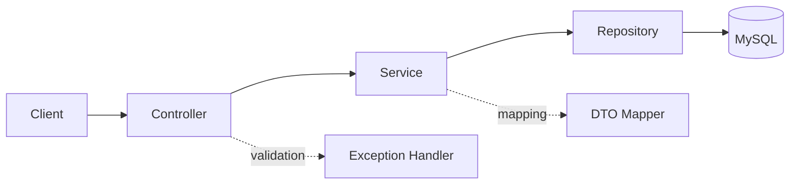
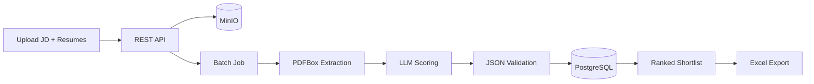

# Mohamed Samer Abdalla

### Software Engineer · Java · Spring Boot · Quality Engineering

*I build backend systems that are clean, tested, and ready for production, with a QA engineer's instinct for what can go wrong.*

  
  
  
  
  

  
  
  
  

---

## About

I'm a software engineer with 2+ years in enterprise systems, working across testing, requirements analysis, and delivery. That background shapes how I write code: I think about failure modes, API contracts, and testability from the first commit.

I'm focused on **Java backend engineering**, specifically REST API design, data modeling with JPA, layered architecture, and automated testing. I also use AI tools (Claude Code, Codex) in my workflow for analysis, test generation, and debugging, and I always review the output myself.

**Currently**
- Building Spring Boot backend projects (below)
- Completing the *IBM Java Developer Professional Certificate*
- Targeting **Java Backend Developer**, **Spring Boot Developer**, and **Java QA Automation Engineer** roles

---

## Tech Stack

| Area | Technologies |
|------|--------------|
| **Languages** |    |
| **Frameworks** |     |
| **Data** |   |
| **Testing** |       |
| **Tooling** |      |
| **AI-assisted** |   |

---

## Featured Projects

### 1. Employee Information System

A layered **Spring Boot REST API** for employee-record management, built around clean separation of concerns, validated input, and consistent error handling.

**Highlights**
- Full **CRUD** over a REST contract with correct HTTP semantics and status codes
- **DTO layer** separating API models from JPA entities
- **Bean Validation** on request payloads, with centralized error responses via `@RestControllerAdvice` (RFC 7807 `ProblemDetail`)
- **Pagination and sorting** through Spring Data
- Interactive API documentation with **Swagger / OpenAPI**
- Unit tests (JUnit 5, Mockito) and controller tests (MockMvc)

**Architecture**

**Endpoints**

| Method | Path | Description |
|--------|------|-------------|
| `POST` | `/api/employees` | Create an employee |
| `GET` | `/api/employees` | List employees (paged, sortable) |
| `GET` | `/api/employees/{id}` | Get one employee |
| `PUT` | `/api/employees/{id}` | Update an employee |
| `DELETE` | `/api/employees/{id}` | Delete an employee |

---

### 2. AI-Powered Resume Screener

A **Spring Boot + LLM** service that ranks candidates against a job description. Upload a JD and a batch of resumes; the system extracts text, scores each candidate with structured LLM output, and returns a ranked shortlist with a justification for every score.

**Highlights**
- **PDF text extraction and cleanup** with Apache PDFBox
- **Prompt engineering** for skill extraction, returning structured JSON that is validated before use
- **Asynchronous batch scoring** for large resume sets (Spring Batch)
- **Configurable scoring weights** (skills, experience, education) per job description
- **Ranked shortlist** with per-candidate justification, exportable to Excel
- Resume files stored in **MinIO**, results in **PostgreSQL**, everything runnable with **Docker Compose**

**Pipeline**

---

### 3. Test Generator: Java & OOP

A Java application that builds tests from instructor-provided questions, with object-oriented design applied to question management, test generation, and output.

---

### 4. Active Accident Prevention: Graduation Project (A+)

A vehicle-safety prototype combining **lane-departure warning** and **traffic-sign detection**. A HuskyLens AI camera and sensors recognize signs and alert the driver when the vehicle drifts out of its lane.

---

## Experience

| Role | Company | Period |
|------|---------|--------|
| **Software Test Engineer** | Madkour Technology | Oct 2025 – Present |
| **System Engineer** | Paragon Developments | Mar 2024 – Sep 2025 |
| **Software Engineering Intern** | ACUD | Aug 2023 – Jan 2024 |

- Validate an enterprise platform end to end: functional, regression, role-based access, and **JMeter performance testing**
- Build **AI-assisted QA workflows** that produce test plans, cases, and reports, reviewed before use
- Translate stakeholder needs into requirements and user stories through gap analysis
- Tested Zoho CRM, Odoo HR, Procore, Autodesk Docs, and an ERP system

---

## Engineering Principles

- **Clean layering:** controllers stay thin, business rules live in services, persistence stays behind repositories
- **Contract first:** explicit DTOs, validation, and predictable error responses
- **Test what matters:** unit tests for logic, slice tests for the web layer, integration tests against real databases
- **Reproducible setups:** Docker for local environments, Maven for builds
- **Review everything:** AI-generated code and tests get the same scrutiny as any other change

---

## Education & Learning

- **B.Sc. Software Engineering**, Arab Academy for Science, Technology and Maritime Transport (2019 – 2023)
- **IBM Java Developer Professional Certificate**, Coursera *(in progress)*
- **Java Spring Boot 3 & Spring 6**, Udemy *(completed)*
- **Software Testing Bootcamp**, Nezam Academy
- **Performance Testing with JMeter**, SWQ Academy

---

## Let's Connect

I'm open to Java backend and Spring Boot opportunities, and happy to talk about API design, testing strategy, or AI-assisted engineering.

