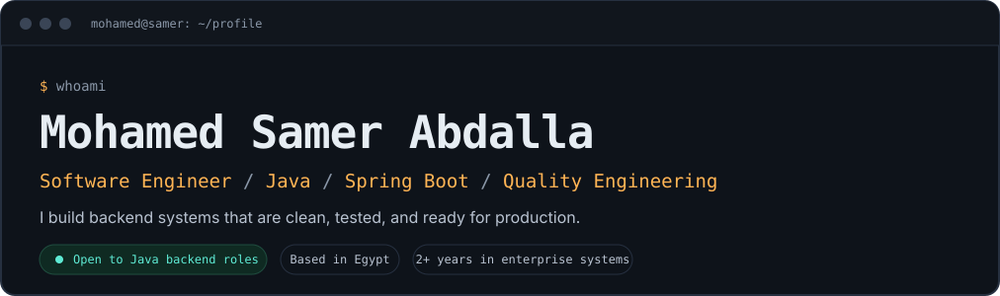
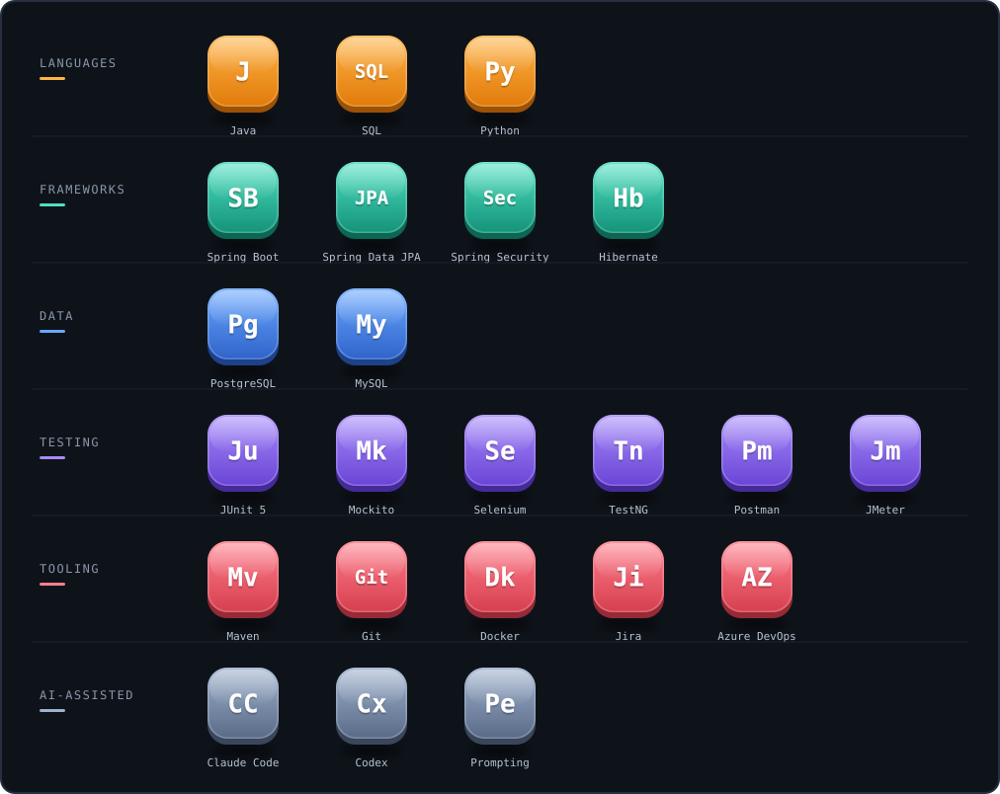
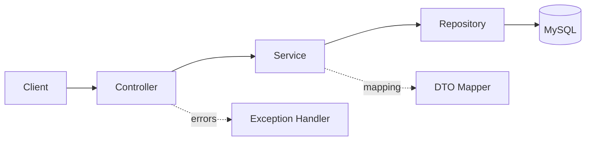
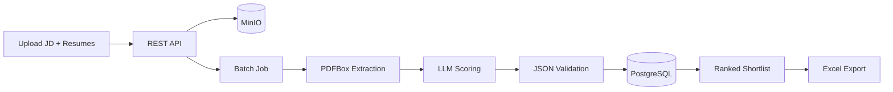

<div align="center">



<br />

<a href="mailto:muhamedsamer286@gmail.com"></a>
<a href="https://www.linkedin.com/in/mohamed-samer"></a>

</div>

<br />

## `01` About

I'm a software engineer with 2+ years in enterprise systems, working across testing, requirements analysis, and delivery. That background shapes how I write code: I think about failure modes, API contracts, and testability from the first commit.

My focus is **Java backend engineering**: REST API design, data modeling with JPA, layered architecture, and automated testing. I use AI tools such as Claude Code and Codex for analysis, test generation, and debugging, and I always review the output myself.

```yaml
# profile.yml
role: Software Engineer
focus: Java backend, REST APIs
Stack: Java, Spring Boot, JPA
learning: IBM Java Developer Professional Certificate
targets:
  - Java Backend Developer
  - Spring Boot Developer
  - Java QA Automation Engineer
```

<br />

## `02` Tech Stack

<div align="center">

</div>

<br />

## `03` Featured projects

<table>
<tr>
<td width="50%" valign="top">

### Employee Information System
`01 / REST API`

A layered Spring Boot API for employee-record management, built around clean separation of concerns, validated input, and consistent error handling.


- Full CRUD with correct HTTP semantics and status codes
- DTO layer, Bean Validation, centralized error responses (RFC 7807)
- Pagination, sorting, and OpenAPI documentation
- Unit tests (JUnit 5, Mockito) and controller tests (MockMvc)

| Method | Path |
|--------|------|
| `POST` | `/api/employees` |
| `GET` | `/api/employees`, `/api/employees/{id}` |
| `PUT` | `/api/employees/{id}` |
| `DELETE` | `/api/employees/{id}` |

</td>
<td width="50%" valign="top">

### AI-Powered Resume Screener
`02 / SPRING BOOT + LLM`

Upload a job description and a batch of resumes. The service extracts text, scores each candidate with structured LLM output, and returns a ranked shortlist with a justification for every score.


- PDF extraction with Apache PDFBox
- Validated JSON from the LLM before any score is stored
- Asynchronous batch scoring with configurable weights
- Ranked shortlist exportable to Excel, runnable with Docker Compose

</td>
</tr>
</table>

**Employee Information System: architecture**



**AI Resume Screener: pipeline**



<table>
<tr>
<td width="50%" valign="top">

### Test Generator
`03 / JAVA + OOP`

Builds tests from instructor-provided questions, with object-oriented design applied to question management, test generation, and output.

</td>
<td width="50%" valign="top">

### Active Accident Prevention
`04 / EMBEDDED + ML, GRADE A+`

Graduation prototype combining lane-departure warning and traffic-sign detection with a HuskyLens AI camera, sensors, and driver alerts.

</td>
</tr>
</table>

<br />

## `04` Experience

| Period | Role | Highlights |
|--------|------|------------|
| **Oct 2025 – Present** | Software Test Engineer, **Madkour Technology** | End-to-end validation of an enterprise platform (functional, regression, role-based access, JMeter performance). AI-assisted QA workflows that produce test plans, cases, and reports, reviewed before use. |
| **Mar 2024 – Sep 2025** | System Engineer, **Paragon Developments** | Redesigned Zoho CRM workflows. Tested an internal OKR portal, Procore, Autodesk Docs, and Odoo HR across workflow, integration, and permission scenarios. |
| **Aug 2023 – Jan 2024** | Software Engineering Intern, **ACUD** | Tested the ACUD ERP system, maintained test cases in Redmine, and took part in CRM integration testing, mobile testing, and requirements workshops. |

<br />

## `05` Engineering principles

| Principle | In practice |
|-----------|-------------|
| **Clean layering** | Thin controllers, rules in services, persistence behind repositories |
| **Contract first** | Explicit DTOs, validation, predictable error responses |
| **Test what matters** | Unit tests for logic, slice tests for the web layer, integration tests against real databases |
| **Reproducible setups** | Docker for local environments, Maven for builds |
| **Review everything** | AI-generated code gets the same scrutiny as any other change |

<br />

## `06` Education

- **B.Sc. Software Engineering**, Arab Academy for Science, Technology and Maritime Transport (2019 – 2023)
- **IBM Java Developer Professional Certificate**, Coursera *(in progress)*
- **Java Spring Boot 3 and Spring 6**, Udemy *(completed)*
- **Software Testing Bootcamp**, Nezam Academy
- **Performance Testing with JMeter**, SWQ Academy

<br />

<div align="center">

### Let's build something reliable.

I'm open to Java backend and Spring Boot opportunities, and happy to talk about API design, testing strategy, or AI-assisted engineering.

<a href="mailto:muhamedsamer286@gmail.com"></a>
<a href="https://www.linkedin.com/in/mohamed-samer"></a>

</div>
